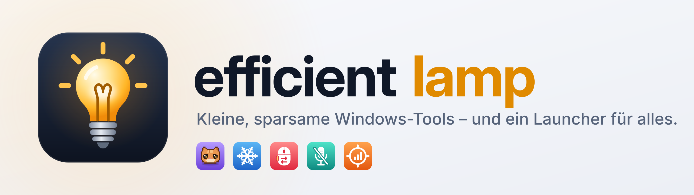
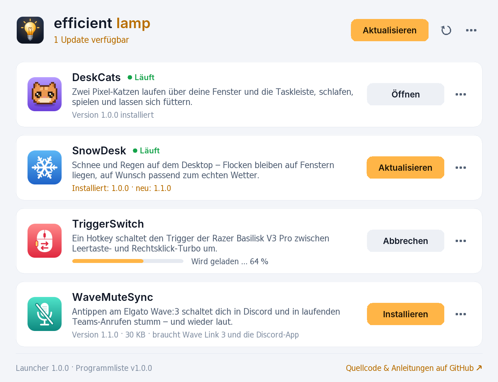
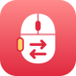
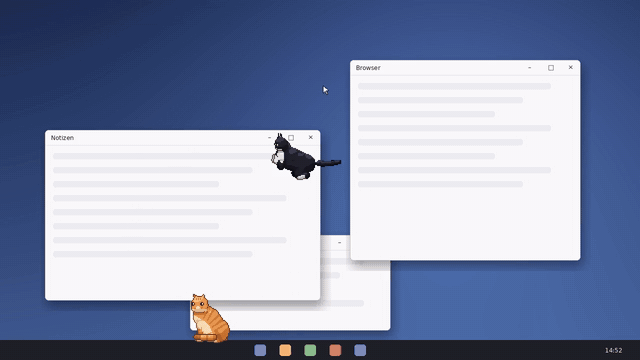
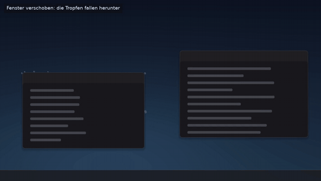
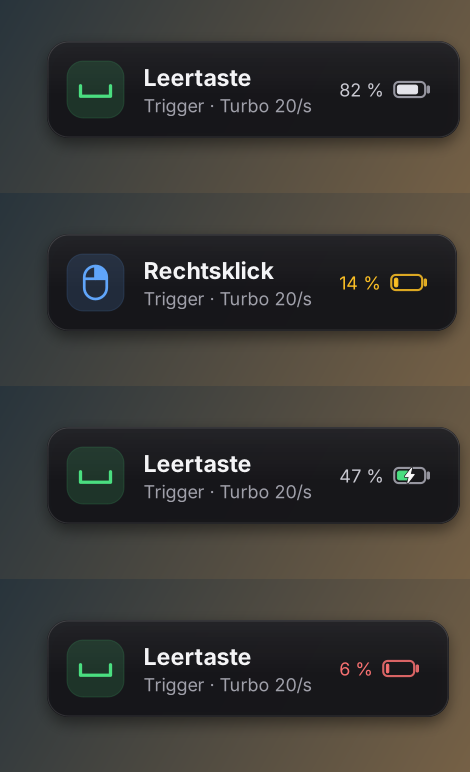

<p align="center">
  <picture>
    <source media="(prefers-color-scheme: dark)" srcset="docs/media/banner-dark.png">
    
  </picture>
</p>

<p align="center">
  <a href="https://github.com/Micha040/effective-lamp/releases/latest"></a>
  <a href="https://github.com/Micha040/effective-lamp/actions/workflows/build.yml"></a>
  
  <a href="LICENSE"></a>
</p>

<p align="center">
  <a href="https://github.com/Micha040/effective-lamp/releases/latest/download/EfficientLamp.exe"><b>⬇&nbsp;Launcher herunterladen (EfficientLamp.exe)</b></a>
  <br>
  <sub>Windows 10 &amp; 11 · ca. 0,7 MB · ohne Administratorrechte · oder <a href="#einzeln-herunterladen">jedes Programm einzeln als ZIP</a></sub>
</p>

> **English:** *efficient lamp* is a small collection of resource-friendly Windows 10/11 tools – pixel-art cats that live
> on your desktop, snow and real weather on your windows, a hotkey for the Razer Basilisk V3 Pro trigger and a mute sync
> for the Elgato Wave:3 – plus a launcher that installs, updates and opens all of them straight from this repository's
> releases. Every download is checked with SHA-256, nothing needs to keep running in the background, and nothing hooks
> into games. The programs and their documentation are in German.

---

## Inhalt

- [Schnellstart](#schnellstart)
- [Die Programme](#die-programme) – [DeskCats](#deskcats) · [SnowDesk](#snowdesk) · [TriggerSwitch](#triggerswitch) · [WaveMuteSync](#wavemutesync)
- [Der Launcher](#der-launcher)
- [Einzeln herunterladen](#einzeln-herunterladen)
- [Sicherheit, Anti-Cheat und Ressourcen](#sicherheit-anti-cheat-und-ressourcen)
- [Für Entwickler](#für-entwickler)

## Schnellstart

1. **[EfficientLamp.exe herunterladen](https://github.com/Micha040/effective-lamp/releases/latest/download/EfficientLamp.exe)** und starten.
   Weil das Programm nicht signiert ist, meldet Windows beim ersten Mal „Der Computer wurde durch Windows geschützt“:
   auf **Weitere Informationen → Trotzdem ausführen** klicken.
2. Der Launcher richtet sich einmalig ein (Startmenü-Eintrag **efficient lamp**, nur für deinen Benutzer) und zeigt alle Programme.
3. Beim gewünschten Programm auf **Installieren** klicken. Das Setup-Fenster des Programms öffnet sich und führt durch die letzten Schritte.

Später zeigt der Launcher, was läuft und wofür es ein Update gibt – ein Klick auf **Aktualisieren** genügt.

<p align="center">
  <picture>
    <source media="(prefers-color-scheme: dark)" srcset="docs/media/launcher-dark.png">
    
  </picture>
</p>

## Die Programme

| | Programm | Kurz gesagt | Version |
|:-:|---|---|:-:|
|  | **[DeskCats](#deskcats)** | Zwei Pixel-Katzen wohnen auf Taskleiste und Fenstern | 1.0.0 |
|  | **[SnowDesk](#snowdesk)** | Schnee, Regen und echtes Wetter auf dem Desktop | 1.1.0 |
|  | **[TriggerSwitch](#triggerswitch)** | Trigger der Razer Basilisk V3 Pro per Hotkey umschalten | 1.1.0 |
|  | **[WaveMuteSync](#wavemutesync)** | Wave:3 stummschalten → Discord und Teams stumm | 1.1.0 |

### DeskCats


**Fatos und Kosta wohnen auf deinem Desktop** – als Pixel-Art-Katzen, die auf der Taskleiste und auf den Oberkanten
deiner Fenster sitzen, herumspazieren, über Bildschirmgrenzen springen, sich putzen und schlafen. Du kannst sie füttern,
mit dem Wollknäuel spielen lassen, streicheln und herumtragen – alles über das Rechtsklick-Menü des Desktops.

- bewegt sich mit, wenn du Fenster verschiebst, schließt oder minimierst
- mehrere Monitore mit unterschiedlicher Skalierung
- schläft ein, wenn nichts passiert, und braucht dann praktisch keine Rechenzeit; bei Spielen im Vollbild pausiert sie ganz

<p align="center"></p>

[Anleitung](apps/deskcats/README.md) · [Quellcode](apps/deskcats) · [ZIP herunterladen](https://github.com/Micha040/effective-lamp/releases/latest/download/DeskCats.zip)

### SnowDesk


**Schnee fällt auf deinen Desktop-Hintergrund, bleibt auf den Fenstern liegen** und rutscht herunter, sobald du ein
Fenster bewegst. Mit **Echtes Wetter** zeigt SnowDesk, was draußen gerade los ist: Regen mit Tropfen an den
Fensterkanten, Schnee, Schneeregen, Nebel, Gewitter, Wind aus der echten Richtung – und liegender Schnee taut bei Plusgraden.

- Wetterdaten von [Open-Meteo](https://open-meteo.com) (kostenlos, ohne Konto), alle 15 Minuten
- zeichnet mit der Grafikkarte und hört auf zu zeichnen, wenn sich nichts bewegt
- Stärke, Flocken, Wind und „liegen bleiben“ frei einstellbar

<p align="center"></p>

[Anleitung](apps/snowdesk/README.md) · [Quellcode](apps/snowdesk) · [ZIP herunterladen](https://github.com/Micha040/effective-lamp/releases/latest/download/SnowDesk.zip)

### TriggerSwitch


**Ein Hotkey (Standard: Strg+Alt+F11) schaltet den Multifunktions-Trigger der Razer Basilisk V3 Pro um** –
zwischen Leertaste-Turbo und Rechtsklick-Turbo. Ein kleines Overlay zeigt für ein paar Sekunden den Modus und den
Akkustand der Maus. Den Turbo erzeugt die Maus selbst; TriggerSwitch schreibt nur die Belegung ins Arbeitsprofil
der Maus (dein gespeichertes Synapse-Profil bleibt unverändert).

<p align="center"></p>

[Anleitung](apps/triggerswitch/README.md) · [Quellcode](apps/triggerswitch) · [ZIP herunterladen](https://github.com/Micha040/effective-lamp/releases/latest/download/TriggerSwitch.zip)

### WaveMuteSync


**Tippst du oben aufs Elgato Wave:3, bist du auch in Discord stumm** – und in einem laufenden Microsoft-Teams-Anruf
ebenfalls. Erneut tippen, und du bist überall wieder zu hören. Den Mute-Zustand liefert Wave Link 3, Discord wird
über seine lokale Schnittstelle gesteuert, Teams über die Windows-Bedienungshilfen. Beim Start oder beim Beitreten
zu einem Anruf wird nur stummgeschaltet, nie automatisch entstummt.

```
Wave:3 (Antippen) ──► Wave Link 3 ──► WaveMuteSync ──┬──► Discord  (lokale RPC-Schnittstelle)
                                                     └──► Teams    (Mikrofon-Knopf im Anruf)
```

[Anleitung](apps/wavemutesync/README.md) · [Quellcode](apps/wavemutesync) · [ZIP herunterladen](https://github.com/Micha040/effective-lamp/releases/latest/download/WaveMuteSync.zip)

## Der Launcher


Der Launcher ist ein kleines, eigenständiges Windows-Programm (ca. 0,7 MB). Er holt sich bei jedem Start die
Programmliste aus dem neuesten [Release](https://github.com/Micha040/effective-lamp/releases/latest) und zeigt für jedes
Programm, ob es installiert ist, ob es gerade läuft und ob es eine neue Version gibt.

- **Installieren / Aktualisieren:** lädt das Paket aus dem Release, prüft Größe und **SHA-256-Prüfsumme**, entpackt es
  und startet das Setup des Programms in einem eigenen Fenster. Passt die Prüfsumme nicht, wird nichts ausgeführt.
- **Öffnen / Einstellungen:** öffnet das Programm bzw. sein Setup-Menü (Hotkey, Overlay, Discord-Verbindung …).
- **Menü „…“ einer Karte:** Installationsordner, Anleitung, neu installieren (reparieren), deinstallieren.
- **Selbst-Update:** gibt es eine neue Launcher-Version, erscheint oben ein Hinweis – ein Klick, fertig.
- Er läuft nur, solange sein Fenster offen ist: kein Dienst, kein Autostart, keine Hintergrundprozesse.

Er richtet sich beim ersten Start unter `%LOCALAPPDATA%\Programs\EfficientLamp` ein, legt einen Startmenü-Eintrag an
und erscheint unter **Einstellungen › Apps › Installierte Apps** – dort lässt er sich auch wieder entfernen
(die installierten Programme bleiben dabei erhalten). Zwischenspeicher und Protokoll liegen in
`%LOCALAPPDATA%\EfficientLamp`. Mit `EfficientLamp.exe --portable` läuft er ohne Einrichtung direkt aus seinem Ordner.

Mehr dazu: [launcher/README.md](launcher/README.md)

## Einzeln herunterladen

Jedes Programm gibt es auch als ZIP – entpacken und **`Setup.cmd`** doppelklicken:

| Programm | Download | Benötigt |
|---|---|---|
| DeskCats | [DeskCats.zip](https://github.com/Micha040/effective-lamp/releases/latest/download/DeskCats.zip) | – |
| SnowDesk | [SnowDesk.zip](https://github.com/Micha040/effective-lamp/releases/latest/download/SnowDesk.zip) | – |
| TriggerSwitch | [TriggerSwitch.zip](https://github.com/Micha040/effective-lamp/releases/latest/download/TriggerSwitch.zip) | Razer Basilisk V3 Pro |
| WaveMuteSync | [WaveMuteSync.zip](https://github.com/Micha040/effective-lamp/releases/latest/download/WaveMuteSync.zip) | Elgato Wave:3 mit Wave Link 3, Discord-App |

Alle Dateien eines Releases samt Prüfsummen (`SHA256SUMS.txt`) stehen auf der
[Release-Seite](https://github.com/Micha040/effective-lamp/releases/latest).
TriggerSwitch und WaveMuteSync werden als lesbarer Quelltext ausgeliefert und erst auf deinem PC mit dem C#-Compiler
von Windows zur `.exe` übersetzt.

## Sicherheit, Anti-Cheat und Ressourcen

Alle Programme sind so gebaut, dass sie neben Spielen mit Anti-Cheat (z. B. CS2 mit FACEIT) unauffällig bleiben:

- **keine** Treiber, **keine** DLL-Injektion, **keine** Tastatur- oder Maus-Hooks, **keine** simulierten Eingaben
- andere Programme werden nur am Prozessnamen erkannt (Toolhelp-Schnappschuss) – nie geöffnet, nie verändert
- DeskCats und SnowDesk pausieren bei Spielen im Vollbild und auf Wunsch bei Programmen aus einer Spieleliste
- alles läuft mit normalen Benutzerrechten. Nur DeskCats und SnowDesk fragen beim Setup einmal nach Administratorrechten –
  ausschließlich für den Eintrag im Rechtsklick-Menü des Desktops (ohne geht es auch, dann unter „Weitere Optionen anzeigen“)

Zu **TriggerSwitch:** Den Turbo erzeugt die Maus selbst. Ob Turbo-Belegungen in einem Spiel oder einer Liga erlaubt sind,
legen deren Regeln fest – Valve und FACEIT sehen Makros und Turbo kritisch.

Die Release-Dateien baut [GitHub Actions](.github/workflows/release.yml) aus genau diesem Quellcode; der Launcher
vergleicht jeden Download mit den Prüfsummen aus `catalog.json`.

## Für Entwickler

```
apps/
  deskcats/        C++ (Win32), Pixel-Art-Katzen          build.sh · tests/run.sh · setup/ · app.json
  snowdesk/        C++ (Win32, Direct3D 11)                build.sh · tests/run.sh · setup/ · app.json
  triggerswitch/   C#-Quelltext + PowerShell-Setup         app.json
  wavemutesync/    C#-Quelltext + PowerShell-Setup         app.json
launcher/          der Launcher (C++, Win32 + GDI+)       build.sh · tests/run.sh
brand/             Logo, App-Kacheln, Banner (SVG) + make_brand.py
docs/              Katalog-Format, Entwicklung, Bilder für diese Seite
tools/             build-all.sh (alles bauen) · package.py (ZIPs + catalog.json)
```

Gebaut wird unter Linux mit MinGW-w64 (`sh tools/build-all.sh`), Release-Pakete erzeugt `tools/package.py`.
Ein neuer Tag `vX.Y.Z` baut und veröffentlicht automatisch ein Release.
Details: [docs/entwicklung.md](docs/entwicklung.md) · Aufbau von `catalog.json`: [docs/katalog.md](docs/katalog.md)

## Lizenz

[MIT](LICENSE) – mach damit, was du möchtest.
