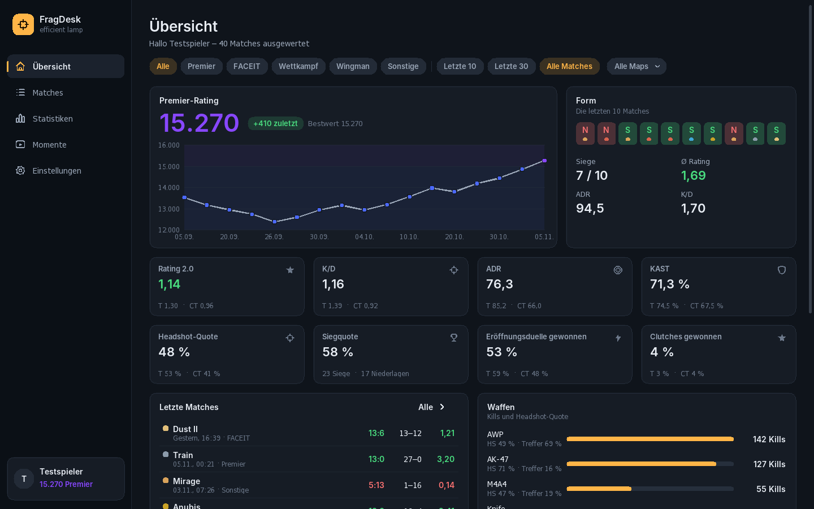
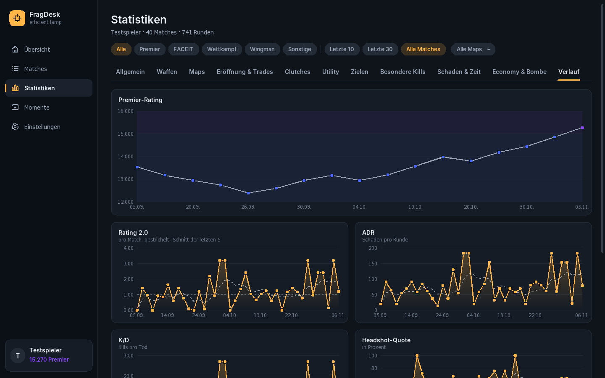
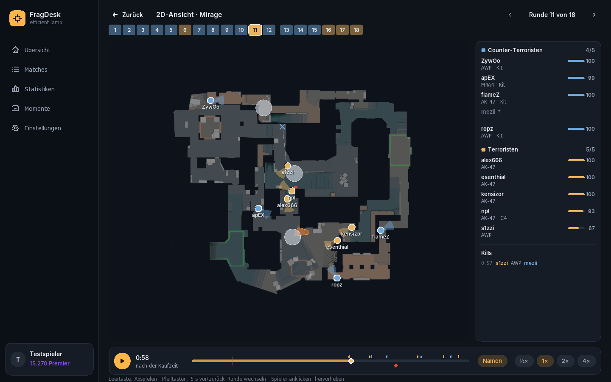
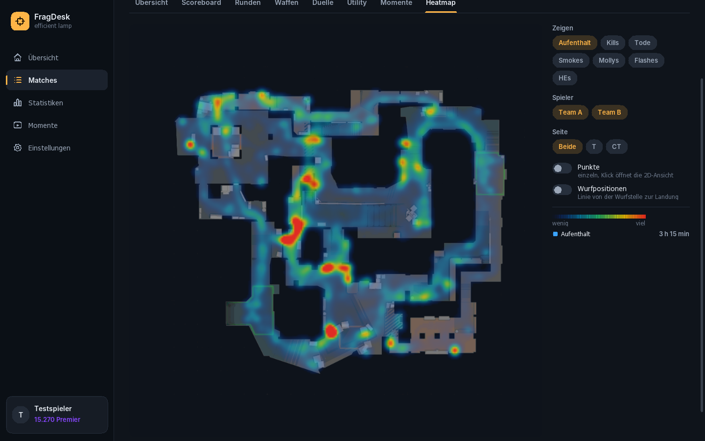

# FragDesk ⌖

> Teil von **[efficient lamp](https://github.com/Micha040/effective-lamp)** – am bequemsten über den [Launcher](https://github.com/Micha040/effective-lamp/releases/latest/download/EfficientLamp.exe) installieren und aktuell halten,
> oder direkt als [FragDesk.zip](https://github.com/Micha040/effective-lamp/releases/latest/download/FragDesk.zip) herunterladen.

**Deine CS2-Stats und Highlights – komplett auf deinem PC.** FragDesk liest deine Demos (Premier, Wettkampf, Wingman,
FACEIT) und zeigt daraus über 150 Kennzahlen, deinen Premier-Verlauf als Graph, jedes Match bis zur einzelnen Runde,
jede Runde als **2D-Ansicht von oben**, **Heatmaps**, dein **Crosshair-Placement** und deine **Reaktionszeit** – und
die Momente, die sich lohnen: Multikills, gewonnene Clutches, Noscopes, Wallbangs, Kills durch Smoke und mehr. Welche
Demo ausgewertet und welcher Moment als Video aufgenommen wird, entscheidest du. Mit der **[Handy-App](#handy-app)** hast
du Stats und Clips auch auf dem iPhone oder Android-Handy.

<p align="center"></p>

## Installieren

1. ZIP komplett entpacken (z. B. nach „Downloads\FragDesk“).
2. **`Setup.cmd`** doppelklicken. Kommt „Der Computer wurde durch Windows geschützt“: „Weitere Informationen“ →
   „Trotzdem ausführen“ (FragDesk ist nicht signiert, deshalb kennt Windows es nicht).
3. Fertig – das Setup braucht **keine Administratorrechte**, legt einen Startmenü-Eintrag an und bietet FragDesk bei
   `.dem`-Dateien unter „Öffnen mit“ an (deine Standard-App für Demos bleibt, wie sie ist).

Installiert wird nach `%LOCALAPPDATA%\Programs\FragDesk`. **Kein Autostart:** FragDesk läuft nur, solange sein Fenster
offen ist. Noch einmal `Setup.cmd` starten (z. B. mit einer neueren Version) aktualisiert die Installation, deine
Auswertungen und Einstellungen bleiben erhalten.

Voraussetzungen: Windows 10 oder 11 (64 Bit). Für Videos zusätzlich Steam, CS2 und die kostenlosen
**CS2 Workshop Tools** (siehe [Videos aufnehmen](#videos-aufnehmen)); den Spielton nimmt FragDesk ab Windows 10
Version 2004 auf.

## Woher kommen die Demos?

FragDesk schaut in diese Ordner und listet neue Demos unter **Matches › Neue Demos** auf (es öffnet dabei nur Dateien,
nie andere Programme):

| Quelle | So kommst du an die Demo |
|---|---|
| **Premier, Wettkampf, Wingman** | in CS2 unter **Deine Matches** beim Match auf „Herunterladen“ – CS2 legt die Demo in `game\csgo\replays` ab, FragDesk findet sie dort |
| **FACEIT** | auf der Match-Seite „Demo ansehen/herunterladen“ – die Datei (`.dem.zst` oder `.dem.gz`) landet im Downloads-Ordner, FragDesk entpackt sie selbst |
| **alles andere** | weitere Ordner in den Einstellungen hinzufügen, Demos ins Fenster ziehen oder „Demos hinzufügen“ |
| **vom eigenen Server** | mit [eigenem Server](#eigener-server) holt FragDesk fertig ausgewertete Matches, die der Server selbst bei Valve geladen hat oder die von einem anderen PC kommen – die Demo dazu auf Klick mit [„Demo von Valve laden“](#matches-vom-server-am-pc) |

**Auswerten** startest du pro Demo selbst (oder „Alle auswerten“). Eine Demo braucht dafür meist 2–10 Sekunden.
Wer es automatisch mag: Einstellungen › „Neue Demos sofort auswerten“.

## Was du siehst

- **Übersicht:** Premier-Rating mit Verlauf (Farben wie im Spiel), Form der letzten 10 Matches, die wichtigsten
  Kennzahlen mit T- und CT-Seite, letzte Matches, beste Waffen und Maps, deine besten Momente.
  Filter für Modus (Premier, FACEIT, Wettkampf …), Zeitraum (letzte 10 / 30 / alle) und Map gelten für alles.
- **Matches:** alle ausgewerteten Matches als sortierbare Tabelle. Ein Klick öffnet das Match mit acht Bereichen:
  *Übersicht* (Rundenstreifen mit Kills und Clutches) · *Scoreboard* (beide Teams, Rating, ADR, KAST, Crosshair-Placement,
  Reaktionszeit, Eröffnungen, Clutches, Utility, MVPs, Premier vorher/nachher) · *Runden* (Kauf, Schaden, Tod, Eröffnung) ·
  *Waffen* (Kills, Treffer, Kopfquote, Körperzonen, „gestorben durch“) · *Duelle* (gegen jeden Gegner, kompletter
  Killfeed) · *Utility* · *Momente* · *Heatmap*. Die Werte jedes anderen Spielers lassen sich ebenfalls anzeigen.
- **2D-Ansicht:** jede Runde von oben zum Abspielen – wo alle stehen und hinschauen, Smokes, Mollys, Flashes und
  HEs, Kills, Bombe (siehe [unten](#2d-ansicht)).
- **Statistiken:** über 150 Kennzahlen in zwölf Bereichen – Allgemein, Waffen, Maps, Eröffnung & Trades, Clutches
  (1v1 bis 1v5), Utility (Flashes, geblendete Gegner, Blendzeit, Flash-Assists …), Zielen (Crosshair-Placement und
  Reaktionszeit, auch nach Waffenart, Treffsicherheit, erster Schuss, Spray, in Bewegung, Trefferzonen), Besondere
  Kills (Wallbang, Noscope, durch Smoke, geblendet, im Sprung …), Schaden & Zeit, Economy & Bombe, **Verlauf**
  (Premier, Rating, ADR, K/D, KAST, HS-Quote, Crosshair-Placement, Reaktionszeit als Graphen) und **Heatmaps** pro Map
  über alle Matches. Jede Kennzahl hat einen Tooltip mit Erklärung.
- **Momente:** alle erkannten Highlights, nach Wert sortiert, mit **In CS2 ansehen** und **Aufnehmen**;
  dazu die Liste deiner Videos.

<p align="center"></p>

### Wie Momente erkannt werden

Jede Runde jedes Spielers bekommt Punkte: für die Zahl der Kills (Doppelkill bis Ass), für gewonnene Clutches
(je mehr Gegner, desto mehr) und für Besonderes – Noscope, Wallbang, durch Smoke, geblendet, im Sprung, Messer,
Zeus, weiter Schuss, zwei auf einen Streich, alles Kopfschüsse, schnelle Folge. Ab einer Schwelle ist es ein Moment;
der Ausschnitt beginnt 4 Sekunden vor dem ersten Kill und endet 2 Sekunden nach dem letzten (bei Clutches die ganze
entscheidende Phase).

## 2D-Ansicht

Im Match oben auf **2D-Ansicht** – oder direkt auf eine Runde im Rundenstreifen bzw. im Bereich *Runden* klicken.
Zu sehen ist die Runde auf der Karte von oben, so wie im Radar:

- **Spieler** als Punkte in Teamfarbe mit Blickrichtung (Kegel), HP-Ring, Name; Bombenträger, Entschärfen/Legen,
  geblendet und Schüsse sind markiert. Ein Klick auf einen Spieler (auf der Karte oder in der Liste) hebt ihn hervor.
- **Granaten:** Flugbahn, dann die Wirkung – Smoke (so lange sie steht), Molotov/Brandgranate als tatsächliche
  Feuerfläche, Flash, HE, Decoy.
- **Kills** als Kreuz mit kurzer Linie vom Schützen, rechts die Killliste mit Zeit (Klick springt kurz davor);
  **Bombe** liegend, gelegt (mit Restzeit) und entschärft.
- Unten die **Zeitleiste** mit allen Kills und Bomben-Ereignissen, Tempo ½× bis 4×.
  Tasten: **Leertaste** Abspielen/Anhalten, **Pfeile links/rechts** 5 Sekunden, **Pfeile hoch/runter** Runde,
  **Esc** zurück.

<p align="center"></p>

Beim ersten Öffnen liest FragDesk die Demo einmal komplett (wieder mit `fdanalyze.exe`, ein paar Sekunden) und legt
die Positionen neben die Auswertung (`matches\<Prüfsumme>.replay`, 0,5–3 MB pro Match); danach geht es sofort und
auch ohne die Demo. Positionen werden 8-mal pro Sekunde gespeichert und dazwischen weich verschoben – für genaue
Pixel-Duelle ist die Demo in CS2 das Original. Radarbilder gibt es für alle aktuellen Karten; bei einer unbekannten
Karte stehen die Punkte auf einem Raster.

## Heatmaps

Pro Match im Tab **Heatmap**, über alle Matches einer Map unter **Statistiken › Heatmaps** (dort gelten die Filter für
Modus und Zeitraum). Auf dem Radarbild lässt sich ein- und ausschalten, was zu sehen ist:

- **Aufenthalt:** wo die gewählten Spieler während der Runden waren (einmal pro Sekunde, ohne Kaufzeit).
- **Kills** (vom Ort des Schützen) und **Tode**.
- **Smokes, Mollys, Flashes, HEs** am Landepunkt – wie viel wo landet. Mit **Wurfpositionen** dazu eine Linie von der
  Stelle, an der geworfen wurde, also die Lineups.
- **Spieler:** Ich, mein Team, Gegner (einzeln oder zusammen), **Seite:** beide, T oder CT.
- **Punkte:** jedes Ereignis einzeln mit Tooltip (Runde, Zeit, wer, Waffe). Ein Klick öffnet die **2D-Ansicht** genau
  dort, 2 Sekunden davor.

Ist eine Ebene allein an, zeigt die Karte den klassischen Verlauf von blau (wenig) bis rot (viel); mehrere Ebenen
bekommen je eine eigene Farbe.

<p align="center"></p>

## Crosshair-Placement und Reaktionszeit

- **Crosshair-Placement:** der Winkel zwischen deinem Fadenkreuz und dem Kopf des Gegners in dem Moment, in dem er für
  dich sichtbar wird – im Schnitt, kleiner ist besser. Dazu der Anteil der Begegnungen mit höchstens 5° („Fadenkreuz am
  Kopf“) und die Aufteilung in waagerecht und senkrecht.
- **Reaktionszeit:** die Zeit vom Sichtbarwerden bis zu deinem ersten Treffer an diesem Gegner (nur Treffer innerhalb
  von 2 Sekunden).

Gezählt wird nur, wenn du eine Schusswaffe in der Hand hast, nicht geblendet bist und der Gegner auf deinem Bildschirm
auftaucht. Taucht er nach mindestens einer Sekunde Pause wieder auf, ist das eine neue Begegnung. „Sichtbar“ meldet
das Spiel selbst (dieselbe Information, mit der es das Radar füllt) – manchmal ein paar Ticks zu spät. Für Vergleiche
und deinen Verlauf taugt das gut, ein Labor-Messwert ist es nicht, und die Zahlen sind nicht dieselben wie bei Leetify.
Zu finden unter **Statistiken › Zielen** (auch nach Gewehr, Scharfschützengewehr, Pistole und MP), im **Verlauf** und
im **Scoreboard** jedes Matches für alle Spieler.

**Ältere Matches:** Heatmap-Daten, Crosshair-Placement und Reaktionszeit entstehen beim Auswerten (ab FragDesk 1.2).
Für Matches, die vorher ausgewertet wurden, zeigt FragDesk einen Hinweis mit **Neu auswerten** – dafür muss die Demo
noch da sein.

## Videos aufnehmen

**Einmalig vorher:** In Steam Rechtsklick auf **Counter-Strike 2 › Eigenschaften › DLC** und bei
**„Counter-Strike 2 Workshop Tools“** „Installieren“ anhaken (kostenlos, von Valve). Warum: FragDesk steuert CS2 über
dessen Konsolen-Schnittstelle (`-netconport`), und die öffnet CS2 unter Windows nur im Workshop-Tools-Modus – ein
seit Jahren offener Fehler im Spiel ([ValveSoftware/csgo-osx-linux#3603](https://github.com/ValveSoftware/csgo-osx-linux/issues/3603)).
Fehlen die Tools, zeigt FragDesk unter **Momente** und in den Einstellungen einen Hinweis.

Bei einem Moment auf **Aufnehmen** (oder mehrere ankreuzen und „Ausgewählte aufnehmen“):

1. FragDesk startet CS2 mit der Demo, springt zum Moment und schaltet auf den Spieler – so, als würdest du selbst die
   Demo ansehen. Zeigt CS2 nach dem Springen den Ladebildschirm, wartet FragDesk, bis wieder das Spiel zu sehen ist.
2. Es nimmt das CS2-Fenster **von außen** auf, wie OBS: Bild per Bildschirmaufnahme, Ton nur von CS2 (kein Discord,
   keine Musik), gespeichert als MP4 (H.264/AAC, mit dem Hardware-Encoder deiner Grafikkarte, wenn vorhanden).
   Dafür hält es das CS2-Fenster ganz oben (wie „Immer im Vordergrund“), lässt CS2 auch ohne Fokus in vollem Tempo
   laufen und schiebt den Mauszeiger aus dem Bild (nur die Position – kein Klick).
3. Danach beendet es CS2 wieder. **Während der Aufnahme den PC bitte nicht benutzen** – aufgenommen wird, was auf
   dem Bildschirm zu sehen ist. Holst du FragDesk zurück (etwa zum Abbrechen), hält es CS2 nicht mehr oben.

Die Videos liegen in **`Videos\FragDesk\<Datum> <Map> <Ergebnis>\`**, z. B. `2026-11-06 Mirage 13-11\R14 3 Kills.mp4`.
Einstellbar sind Ordner, Auflösung (720p / 1080p / 1440p), 30 oder 60 fps, Qualität, „nur Killfeed“ (übriges HUD
aus), Spielton und Sprachchat der Demo.

Für Aufnahmen startet CS2 mit **eigenem Einstellungsordner** (`%LOCALAPPDATA%\FragDesk\cs2`): Fenstergröße,
ausgeblendetes HUD und Co. landen nie in deinen echten CS2-Einstellungen. Zur Sicherheit merkt sich FragDesk vorher
deine CS2-Einstellungsdateien und stellt sie danach wieder her, falls sich doch etwas geändert hat. Passt die
gewählte Auflösung nicht als Fenster auf den Monitor, nimmt FragDesk ein randloses Fenster in Monitorgröße.
Wird CS2 während der Aufnahme geschlossen, minimiert oder verschoben, bricht FragDesk ab, statt den Desktop
aufzunehmen.

**Manche Demos kann CS2 selbst nicht abspielen** – vor allem von Community-Servern wie FACEIT: CS2 stürzt dann
direkt nach dem Laden mit `FATAL ERROR: CopyNewEntity: invalid class index … out of range 0` ab
([ValveSoftware/csgo-osx-linux#4543](https://github.com/ValveSoftware/csgo-osx-linux/issues/4543)). FragDesk erkennt
die Fehlermeldung, verwirft den angefangenen Clip, beendet CS2 und macht mit der nächsten Demo weiter; unter
**Momente** steht dann, was passiert ist. Die Statistiken dieser Demo sind davon nicht betroffen.

**In CS2 ansehen** macht dasselbe ohne Aufnahme und mit deinen normalen Einstellungen; CS2 bleibt danach offen.
Bevor du damit online spielst, starte CS2 einmal normal neu – dieses CS2 läuft noch im Workshop-Tools-Modus mit der
Konsolen-Schnittstelle, über die FragDesk es gesteuert hat.

> **Hinweis:** Läuft etwas nicht rund, steht im Protokoll `%LOCALAPPDATA%\FragDesk\fragdesk.log`
> (Einstellungen › „Datenordner öffnen“), was FragDesk an CS2 geschickt hat und was CS2 zuletzt ausgegeben hat.

## Handy-App

Deine Stats und Clips auf dem Handy – als Web-App, die FragDesk selbst ausliefert: kein App Store, kein Server, keine
Kosten. Zu sehen ist dasselbe wie in FragDesk, fürs Handy umgebaut: **Übersicht**, **Matches** mit allen Bereichen samt
**Heatmap**, **Statistiken** samt Verlauf und Heatmaps, deine **Momente und Videos** und jede Runde in der
**2D-Ansicht**. Ansehen und Aufnehmen in CS2 bleibt am PC.

**Heatmaps** wie in FragDesk: im Match und unter Statistiken › Heatmaps pro Map (die neuesten 200 Matches einer Map).
Ebenen, Spieler und Seite wählen, bei Nuke & Co. die Ebene oben links auf der Karte; mit zwei Fingern vergrößern oder
doppelt tippen. Ein Punkt zeigt, was dort war (Runde, Zeit, wer, Waffe), und führt in die 2D-Ansicht. Gerechnet wird
am PC bzw. auf dem Server und nur, wenn das Handy fragt.

Zwei Wege: **Direkt vom PC** (so wie hier beschrieben – der PC muss an sein) oder über einen **[eigenen
Server](#eigener-server)** (ein paar Euro im Monat; der PC muss nicht an sein, auch mit Freunden teilbar). Umschalten
in FragDesk unter Einstellungen › Handy-App › Verbindung.

**Einrichten (einmalig):**

1. In FragDesk unter **Einstellungen › Handy-App** „Handy-App erlauben“ einschalten. Beim ersten Mal fragt Windows, ob
   FragDesk Verbindungen annehmen darf – „Zugriff zulassen“.
2. **Handy verbinden** und den QR-Code mit der iPhone-Kamera scannen. Safari öffnet FragDesk und verbindet sich.
3. In Safari **Teilen › Zum Home-Bildschirm**. Ab dann startet FragDesk wie eine App im Vollbild. Fragt es dort nach dem
   Code, gib ihn noch einmal ein (er gilt 10 Minuten).

**Zu Hause und unterwegs:** Im Heimnetz geht es sofort. Für unterwegs [Tailscale](https://tailscale.com/download)
(für private Nutzung kostenlos) auf PC und Handy installieren und mit demselben Konto anmelden. FragDesk erkennt das und
nimmt die Tailscale-Adresse für den QR-Code – die gilt zu Hause und unterwegs. Dein PC muss dafür an sein und FragDesk
offen (minimiert reicht).

**Videos aufs Handy:** Im Video auf „Aufs Handy speichern“. Es landet in der Dateien-App unter „Downloads“; dort
Teilen › „Video sichern“, dann ist es in Fotos. Mit einer HTTPS-Adresse (siehe unten) geht es direkt über „Teilen ›
Video sichern“, und die App startet auch ohne Verbindung mit den zuletzt geladenen Daten.

**2D-Ansicht auf dem Handy:** Im Match oben auf **2D-Ansicht**, im Bereich *Runden* auf eine Runde oder auf einen
Moment tippen (der startet 2 Sekunden vorher). Abspielen in ½× bis 4×, Runde wählen, einen Spieler antippen, um ihm zu
folgen („Nah“ zoomt mit); im Querformat steht die Karte groß neben der Steuerung. Gezeichnet wird nur beim Abspielen
und solange die App zu sehen ist – angehalten kostet sie nichts. Hat ein Match noch keine 2D-Daten, erstellt FragDesk
sie beim ersten Öffnen aus der Demo – ein paar Sekunden im Hintergrund, danach geht es von selbst weiter. Ohne Demo
geht es nicht; das Handy sagt dann, warum.

**Sicherheit:** Aus, bis du es einschaltest. Nur gekoppelte Handys kommen an Daten und Videos: Gekoppelt wird mit einem
6-stelligen Code, der nur 10 Minuten gilt und nach 5 Fehlversuchen verfällt; danach meldet sich das Handy mit einem
langen Zufallsschlüssel an. Gekoppelte Handys siehst und entfernst du unter Einstellungen › Handy-App. FragDesk spricht
dabei nur mit deinem Handy im Heimnetz bzw. über Tailscale, nichts geht ins Internet – und mit CS2 oder dem
Anti-Cheat hat das nichts zu tun.

**Rücksicht aufs Spiel:** Solange CS2 läuft, schickt FragDesk keine Videos (die Stats schon – das sind nur ein paar
KB), damit dein Ping nicht leidet, und liest keine Demos für die 2D-Ansicht – das Handy zeigt dann „Wird erstellt,
sobald CS2 zu ist“ und macht danach von selbst weiter. Im Leerlauf kostet die Handy-App nichts; Vorschaubilder der
Videos entstehen einmal und liegen dann in `%LOCALAPPDATA%\FragDesk\thumbs`.

**HTTPS über Tailscale (für Profis):** `tailscale serve --bg 7420` in einer Eingabeaufforderung auf dem PC liefert eine
Adresse wie `https://dein-pc.dein-tailnet.ts.net`. Adresse kopieren und in FragDesk bei „Adresse fürs Handy“ auf
**Eigene einfügen** – dann steht sie im QR-Code. „Automatisch“ nimmt wieder die erkannte Adresse.

**Ohne laufenden PC:** Mit einem [eigenen Server](#eigener-server) liest die Handy-App vom Server – dein PC darf aus
sein, und Freunde können mitmachen.

## Eigener Server

Ein kleiner gemieteter Linux-Server wird zur **Drehscheibe** für deine Stats und Clips – und auf Wunsch die deiner
Freunde. Der Server hat alle Matches: FragDesk am PC lädt seine eigenen hoch und holt sich, was ihm fehlt (z. B. Matches,
die der Server [selbst bei Valve geladen](#demos-automatisch-laden) hat), die Handy-App liest vom Server – dieselbe App
mit denselben Ansichten wie oben, aber dein PC muss nicht an sein und Tailscale brauchst du nicht. Hochgeladen und
geholt wird **nie, während CS2 läuft oder aufgenommen wird**.

**Was du brauchst:** einen VPS mit Debian oder Ubuntu (x86_64), einer eigenen IPv4-Adresse und SSH-Zugang als root.
Klein reicht völlig, z. B. der kleinste netcup-VPS („VPS nano“) für rund 3–4 € im Monat samt IPv4 – Preise ändern
sich, beim Anbieter nachsehen. Platz: ein Match belegt 100–400 KB (Auswertung und Heatmap) plus 0,5–3 MB für die
2D-Ansicht, ein Clip 2–10 MB; 60 GB reichen für Tausende Matches und mehrere Tausend Clips.

**Installieren – ein Befehl** (am PC im Terminal `ssh root@<IP-des-Servers>`, dann auf dem Server):

```sh
curl -fsSL https://raw.githubusercontent.com/Micha040/effective-lamp/main/apps/fragdesk/server/install.sh | bash
```

Als normaler Benutzer statt root: `… | sudo bash`. Fehlt `curl`: erst `apt update && apt install -y curl`.

Das Skript installiert [Caddy](https://caddyserver.com) aus den Paketquellen (HTTPS mit kostenlosem Zertifikat von
Let's Encrypt, erneuert sich selbst), legt den Benutzer `fragdesk` an, holt `fragdesk-server` aus dem neuesten
[Release](https://github.com/Micha040/effective-lamp/releases/latest) (geprüft mit `SHA256SUMS.txt`), richtet den
systemd-Dienst ein, gibt in ufw (falls aktiv) die Ports 80 und 443 frei, startet alles, prüft es – und zeigt zum
Schluss **deine Einladung als Admin**. Für [Demos automatisch laden](#demos-automatisch-laden) kommen Node.js (aus
apt) und zwei Dateien aus dem Release dazu; fehlt Node.js 18, bleibt nur diese Funktion aus.

```
Deine Einladung als Admin – gilt 7 Tage und nur einmal:

  https://203-0-113-5.sslip.io/#invite=…
```

Ohne eigene Domain heißt dein Server `<IP-mit-Bindestrichen>.sslip.io` ([sslip.io](https://sslip.io) zeigt den Namen
kostenlos auf deine IP – das reicht für das Zertifikat). sslip.io nutzen sehr viele; ist Let's Encrypt dort gerade am
Limit, holt Caddy das Zertifikat von selbst bei ZeroSSL (dauert dann ein paar Minuten). Mit eigener Domain (DNS-A-Eintrag
auf die IP des Servers, kostenlos z. B. bei [DuckDNS](https://www.duckdns.org)): `… | bash -s -- --domain stats.example.org`. Erst schauen, was passieren würde: `--dry-run`. Hat dein Anbieter
eine eigene Firewall im Kundenmenü, müssen dort die Ports 80 und 443 offen sein.

**Verbinden:** Den Einladungslink auf den PC bringen (z. B. per Messenger an dich selbst) und kopieren. In FragDesk
unter **Einstellungen › Handy-App** den Modus **„Eigener Server“** wählen und **„Einladung einfügen“**. Ab dann gleicht
FragDesk in beide Richtungen ab – neue Matches und Videos hoch, fehlende Matches vom Server zurück (beim Start, nach jeder
Auswertung und Aufnahme, sonst alle 15 Minuten; Videos in Stücken, ein Abbruch schadet nicht) – und zeigt dort Server,
Konto, Speicher und Stand („41 Matches auf dem PC · 3 vom Server geholt · …“). **„Handy verbinden“** zeigt wie gewohnt
einen QR-Code – jetzt für den Server. Mit dem Schalter „Videos hochladen“ bleiben Videos auf Wunsch am PC;
**„Trennen“** meldet FragDesk vom Server ab.

**2D-Ansicht über den Server:** Der Schalter **„2D-Ansicht hochladen“** (an) lädt die Daten der 2D-Ansicht mit hoch,
rund 2 MB pro Match. Neue Matches bekommen sie gleich beim Auswerten (im selben Durchgang, kaum langsamer); für ältere
erstellt FragDesk sie nach und nach aus der Demo – eins nach dem anderen, mit niedrigster Priorität und nie, während
CS2 läuft oder aufgenommen wird. Matches, deren Demo nicht mehr da ist, bleiben ohne 2D-Ansicht; die Handy-App sagt
dann, warum. Ausgeschaltet bleibt die 2D-Ansicht am PC, und FragDesk erstellt dafür nichts im Hintergrund. Dafür
braucht der Server eine aktuelle Version – ein älterer nimmt keine 2D-Daten an; FragDesk sagt das dann in den
Einstellungen, und der Installationsbefehl von oben, noch einmal ausgeführt, aktualisiert ihn.

**Löschen:** Löschst du in FragDesk ein Match oder Video, verschwindet es beim nächsten Abgleich auch vom Server – auch
ein [vom Server geholtes](#matches-vom-server-am-pc) Match. Fehlt ein Match nur am PC (neuer PC, Datei verloren), holt
FragDesk es vom Server zurück; ein Video, das du im Explorer löschst, um am PC Platz zu sparen, bleibt auf dem Server.

**Neuer PC oder „Trennen“ gedrückt:** In der Handy-App unter **Einstellungen › PC neu verbinden** einen Link holen und
in FragDesk wie eine Einladung einfügen – das verbindet FragDesk wieder mit *deinem* Konto, alle Daten bleiben, und die
Matches holt FragDesk von selbst vom Server (der bisher verbundene PC wird abgemeldet; der Link gilt einen Tag und
einmal). Für Freunde macht das der Admin unter
**Server verwalten** › Konto › „PC neu verbinden“, auf dem Server geht es mit `fragdesk-server invite --user <ID>`
(IDs zeigt `fragdesk-server users`).

**Freunde einladen:** als Admin in FragDesk mit **„Freund einladen“** (der Link landet in der Zwischenablage), in der
Handy-App unter **Einstellungen › Server verwalten** (Link erstellen und direkt teilen) oder auf dem Server mit
`fragdesk-server invite` (`--admin` für einen weiteren Admin, `--days` für die Gültigkeit). Jeder Link gilt
einmal und 7 Tage. Öffnet ihn jemand auf dem Handy, erklärt die Seite, dass er in FragDesk am PC gehört.

**Konten und Speicher:** Jeder hat sein eigenes Konto und sieht nur seine eigenen Stats und Clips. Eingeladene Konten
bekommen 15 GB, Admins unbegrenzt. Unter **Server verwalten** in der Handy-App siehst du alle Konten mit belegtem
Speicher, änderst das Limit (5, 10, 15, 25, 50 GB oder unbegrenzt) und entfernst Konten samt Daten; die Stats der
anderen sieht auch der Admin nicht. Ist ein Speicher voll, lädt FragDesk nichts Neues mehr hoch und sagt das – alles,
was schon oben ist, bleibt zu sehen. Auf dem Server listet `fragdesk-server users` alle Konten (auch, wer „Demos
automatisch laden“ an hat).

**Aktualisieren:** Denselben Befehl noch einmal ausführen. Er holt das neueste Release; Daten, Domain und Zeitzone
bleiben (eine neue Admin-Einladung gibt es nur, solange noch niemand Admin ist).

**Deinstallieren:** `curl -fsSL …/install.sh | bash -s -- --uninstall` entfernt Dienst, Programm, den Helfer samt
Timer und den Caddy-Eintrag. Die Daten bleiben in `/var/lib/fragdesk` – ganz weg damit: `rm -rf /var/lib/fragdesk &&
userdel fragdesk`. Caddy und Node.js bleiben installiert.

**Sicherheit:**

- `fragdesk-server` lauscht nur auf `127.0.0.1:7420`; von außen geht es nur über Caddy und HTTPS.
- FragDesk meldet sich mit einem langen Zufallsschlüssel an, Handys wie gewohnt mit dem 6-stelligen Code (gilt
  10 Minuten, nach 5 Fehlversuchen verfallen) und danach einem eigenen Schlüssel. Auf der Platte liegen Schlüssel und
  Einladungscodes nur als SHA-256 – wer die Dateien kopiert, kann sich damit nicht anmelden.
- Gegen Raten: höchstens 5 falsche Einladungen bzw. Kopplungscodes pro 15 Minuten und IP.
- Der Dienst läuft als eigener Benutzer ohne Rechte, darf nur in `/var/lib/fragdesk` schreiben (0700), keine
  Verbindungen nach außen aufbauen und nur die nötigen Systemaufrufe benutzen (systemd-Härtung).
- Ins Internet darf nur der Helfer für „Demos automatisch laden“ (`fragdesk-fetch.service`): genauso gehärtet, schreibt
  nur in `/var/lib/fragdesk/fetch`, ohne Ausführen von im Speicher erzeugtem Code (Node.js mit `--jitless`).
- `fragdesk-server invite/users` und der Helfer sprechen über 127.0.0.1 mit dem Dienst und brauchen den Schlüssel aus
  `/var/lib/fragdesk/local.key`; von außen sperrt Caddy diese Befehle.
- Wer root auf dem Server hat, kann alle Daten lesen – miete den Server selbst und gib den Zugang nicht weiter.
  Sichern: den Ordner `/var/lib/fragdesk` (oder Snapshots beim Anbieter).

**Ressourcen:** Im Leerlauf schläft der Server (einmal pro Minute räumt er kurz auf) und braucht wenige MB
Arbeitsspeicher. Die Matches eines Kontos lädt er erst, wenn ein Handy fragt (rund 150 KB pro Match), und gibt sie
nach 15 Minuten ohne Handy wieder frei. Heatmaps rechnet er eine nach der anderen und vergisst sie nach 10 Minuten
ohne Heatmap-Anfrage. Für die 2D-Ansicht liest er die Datei des Matches, das gerade ein Handy abspielt (eine zur Zeit),
und schickt immer nur eine Runde (30–150 KB); auch sie gibt er nach 15 Minuten wieder frei. Caddy komprimiert JSON und
Text, Videos nicht. Der Helfer für „Demos automatisch laden“ läuft nur, solange es etwas zu tun gibt (siehe unten).
Uhrzeiten in der Handy-App rechnet der Server in seine Zeitzone um – steht der Server auf UTC, nimmt `install.sh`
Europe/Berlin (`--timezone <Zone>` ändert das).

### Matches vom Server am PC

Was der Server hat und dem PC fehlt, holt FragDesk beim Abgleich im Hintergrund: Auswertung, Heatmap und – mit
„2D-Ansicht hochladen“ – die 2D-Daten; die Liste füllt sich nach und nach. Solche Matches tragen in der
Liste „vom Server“, Stats, Heatmap und 2D-Ansicht gehen sofort. Hochgeladen werden sie nie (der Server hat sie ja), eine
neuere Fassung auf dem Server ersetzt die am PC, und ist eins auf dem Server weg, bleibt es am PC. Löschst du es in
FragDesk, ist es auch auf dem Server weg. Wertest du dieselbe Demo am PC selbst aus, wird daraus ein ganz normales
eigenes Match.

**Demo von Valve laden:** Nur Ansehen, Aufnehmen und Neu auswerten brauchen die Demo. Hat der Server das Match
[selbst bei Valve geholt](#demos-automatisch-laden), kennt er ihre Adresse, und im Match steht ruhig **„Demo nicht auf
diesem PC“** mit dem Knopf **„Demo von Valve laden“** – solange Valve sie aufhebt (etwa einen Monat nach dem Spiel, das
Datum steht dabei). FragDesk lädt sie dann im Hintergrund nach `%LOCALAPPDATA%\FragDesk\demos` (meist 50–200 MB,
höchstens 1 GB) – mit Fortschritt und „Abbrechen“, nie während CS2 läuft: Dann pausiert es und macht danach an
derselben Stelle weiter. Danach gehört die Demo zum Match wie jede andere (gepackt; entpackt wird erst fürs Ansehen und
Aufnehmen). Ist sie bei Valve schon weg, sagt FragDesk das – Stats, Heatmap und 2D-Ansicht bleiben. Löschst du das
Match, löscht FragDesk die geladene Demo mit.

### Demos automatisch laden

Der Server holt neue Matches eines Kontos **selbst bei Valve**, wertet sie aus (Stats, Heatmap, 2D-Ansicht) und legt
sie ins Konto – ohne PC, ohne Klick in CS2. Neue Matches erscheinen von selbst in der Handy-App und – sobald FragDesk
abgleicht – [am PC](#matches-vom-server-am-pc). So machen es auch Leetify & Co.: Mit deinem Authentifizierungscode fragt
der Server bei Steam nach den Freigabecodes deiner neuen Matches, ein eigenes Steam-Konto des Servers (der „Bot“) holt
dazu die Adresse der Demo, und die Demo kommt von Valve.

Einrichten geht in FragDesk unter **Einstellungen › Demos automatisch laden** (mit „Eigener Server“ verbunden) oder in
der Handy-App – beides zeigt denselben Stand. FragDesk hat dafür keine Eingabefelder: Codes und Schlüssel kopierst du
bei Steam, die Knöpfe „… einfügen“ nehmen sie aus der Zwischenablage (geprüft wie auf dem Server); Benutzername und
Passwort des Bots und den Steam-Guard-Code fragt ein kleines Fenster ab.

**Einmal für den ganzen Server (Admin):** in FragDesk unter **Einstellungen › Demos automatisch laden › Steam-Bot**
oder in der Handy-App unter **Server verwalten › Steam-Bot** – dort steht es auch Schritt für Schritt:

1. Ein **neues Steam-Konto** nur für den Server anlegen (nicht dein eigenes!) – deine normale E-Mail-Adresse geht
   auch, Steam erlaubt mehrere Konten pro Adresse.
2. **Counter-Strike 2 hinzufügen** – kostenlos, im Steam-Shop bei CS2 „Spielen“ bzw. „Zur Bibliothek hinzufügen“.
3. **5 € aufladen** (z. B. Steam-Guthabenkarte): Ohne mindestens 5 € Umsatz gibt Valve keinen Web-API-Schlüssel
   heraus. Das Guthaben bleibt auf dem Konto.
4. **Steam Guard mit der Steam-App** einrichten (Steam-App aufs Handy, mit dem Bot anmelden, Authenticator).
5. Den **Web-API-Schlüssel** holen: als Bot auf [steamcommunity.com/dev/apikey](https://steamcommunity.com/dev/apikey),
   als Domain z. B. die Adresse deines Servers, und eintragen (in FragDesk kopieren und „Schlüssel einfügen“). Nimm den
   Schlüssel des Bots – der deines eigenen Kontos ginge auch, läge dann aber auf dem Server, und wer ihn erbeutet, kann
   damit Betrug beim Handeln mit Skins versuchen.
6. **Bot anmelden:** Benutzername und Passwort des Bots, dann den Code aus der E-Mail bzw. der Steam-App eingeben
   oder in der Steam-App bestätigen (FragDesk fragt den Code von selbst ab bzw. wartet, bis du bestätigt hast).

**Jeder für sich (jedes Konto):** in FragDesk unter **Einstellungen › Demos automatisch laden** oder in der Handy-App
unter **Einstellungen › Demos automatisch laden** zwei Codes eintragen und einschalten. Beide stehen auf derselben
[Steam-Seite](https://help.steampowered.com/de/wizard/HelpWithGameIssue/?appid=730&issueid=128): der
**Authentifizierungscode** („Authentifizierungscode erstellen“, Form `AAAA-AAAAA-AAAA`) und der **Freigabecode deines
letzten Matches** (`CSGO-…`). Dafür muss in FragDesk am PC dein Spieler gewählt sein (die SteamID kommt vom PC).
„Jetzt prüfen“ schaut sofort nach, sonst prüft der Server alle 15 Minuten; „Ausschalten“ löscht beide Codes vom Server.
Nach „Jetzt prüfen“ in FragDesk holt es neue Matches gleich, sobald der Server fertig ist.

**Grenzen:** nur **Premier, Wettkampf und Wingman** – FACEIT nicht (das lädt weiter FragDesk am PC hoch). Valve hebt
Demos nur etwa **einen Monat** auf; geladen werden jeweils die Matches *nach* dem eingetragenen Freigabecode. Ist eine
Demo schon gelöscht, überspringt der Server das Match. Das Ganze nutzt Schnittstellen von Valve, die nicht offiziell für
so etwas gedacht sind – ändert Valve etwas, kann es (wie bei Leetify & Co.) eine Weile nicht gehen. Lädt FragDesk am
PC dasselbe Match später hoch, ersetzt es einfach die Server-Fassung (gleiche Prüfsumme).

**Was wo liegt:** Passwort und Steam-Guard-Code des Bots bleiben nur im Arbeitsspeicher des Servers (höchstens
15 Minuten) und landen nie auf der Platte. Gespeichert wird ein Anmelde-Token des Bots wie bei „Angemeldet bleiben“
und der Web-API-Schlüssel – nur in `/var/lib/fragdesk/steam.json` (0600, nur für `fragdesk` lesbar). Der
Authentifizierungscode jedes Kontos liegt in dessen `account.json` (die Handy-App zeigt ihn nur gekürzt, ins Protokoll
kommt er nie); mit ihm lässt sich nur der Spielverlauf abfragen, keine Anmeldung. Name, SteamID und Ablauf des Tokens
des Bots stehen in `server.json`. „Bot abmelden“ löscht das Token, „Ausschalten“ die Codes eines Kontos. Zu jedem
selbst geholten Match merkt sich der Server Adresse und Spielzeit der Demo bei Valve und den Freigabecode
(`<Prüfsumme>.src` neben dem Match, 0600) – für „Demo von Valve laden“ in FragDesk; die Datei geht mit dem Match.

**So läuft es:** Den Weg nach außen hat nur der Helfer `fragdesk-fetch` (Node.js, eigener systemd-Dienst
`fragdesk-fetch.service`, als Benutzer `fragdesk`, darf nur in `/var/lib/fragdesk/fetch` schreiben). Ein Timer startet
ihn alle 15 Minuten, und der Server weckt ihn sofort, wenn er darum bittet (`fetch/wake`, z. B. bei „Jetzt prüfen“). Er
arbeitet ab, was ansteht, und beendet sich – im Leerlauf läuft kein Prozess. Je Match lädt er die Demo (meist
50–200 MB), wertet sie mit `fdanalyze` aus (mit niedrigster Priorität: ein paar Sekunden, rund 200 MB Arbeitsspeicher),
gibt die Ergebnisse dem Server (dieselben Prüfungen und dasselbe Speicherlimit wie beim Hochladen aus FragDesk) und
löscht die Demo wieder. Immer nur ein Match zur Zeit; ein volles Konto lässt er aus, bis wieder Platz ist.

**Wenn es nicht geht:** Die Handy-App zeigt, was der Server zuletzt gemeldet hat (z. B. „Authentifizierungscode passt
nicht“). Auf dem Server:

```sh
journalctl -u fragdesk-fetch -n 200 --no-pager                                          # Protokoll des Helfers
runuser -u fragdesk -- node --jitless /usr/local/lib/fragdesk/fragdesk-fetch.js check   # Umgebung prüfen
```

(mit sudo statt als root: `sudo -u fragdesk node --jitless /usr/local/lib/fragdesk/fragdesk-fetch.js check`).
Node.js 18 oder neuer gibt es in apt z. B. bei Debian 12/13 und Ubuntu 24.04; bei älteren Systemen (Ubuntu 22.04)
meldet `install.sh` das und lässt nur diese Funktion aus.

## Anti-Cheat und Sicherheit

- FragDesk **liest nur Demo-Dateien**. Es greift nie in ein laufendes Spiel ein: keine Injektion, keine Hooks,
  keine simulierten Eingaben, kein Lesen fremden Speichers. (Bei Aufnahmen schiebt es nur den Mauszeiger aus dem
  Bild – im eigenen CS2 für die Aufnahme, das mit keinem Server verbunden ist.)
- CS2 startet es **nur zum Ansehen oder Aufnehmen** – und nur, wenn CS2 gerade nicht läuft. Dabei nutzt es
  ausschließlich offizielle Startoptionen von Valve (`-tools` für den Workshop-Tools-Modus, `+playdemo` und die
  Konsole über `-netconport`), **kein Plugin, keine geänderten Spieldateien**. CS2 spielt dabei nur die Demo auf
  deinem PC ab und verbindet sich mit keinem Server. Für Matches startest du CS2 danach wie gewohnt neu.
- Alles bleibt auf deinem PC: Es wird nichts hochgeladen, FragDesk braucht kein Internet. Die [Handy-App](#handy-app)
  (aus, bis du sie einschaltest) verbindet nur Handys, die du selbst gekoppelt hast – im Heimnetz oder über Tailscale.
  Nur wenn du einen [eigenen Server](#eigener-server) einrichtest, lädt FragDesk Auswertungen, 2D-Daten und Videos
  dorthin und holt Matches von dort – und spricht mit niemandem sonst; einzige Ausnahme ist
  [„Demo von Valve laden“](#matches-vom-server-am-pc): nur auf Klick, direkt von Valves Demo-Servern, ohne Anmeldung.
  Mit [Demos automatisch laden](#demos-automatisch-laden) holt der Server Demos selbst bei Valve – über ein eigenes
  Steam-Konto (den Bot), nie über deins; dein Authentifizierungscode erlaubt nur, deinen Spielverlauf abzufragen.

## Ressourcen

- Im Leerlauf tut FragDesk nichts außer auf neue Dateien in den Demo-Ordnern zu warten (Windows meldet sich dann) und –
  falls die Handy-App an ist – auf Anfragen vom Handy.
- Ausgewertet wird in einem eigenen Prozess (`fdanalyze.exe`) mit niedriger Priorität: ein paar Sekunden lang
  ca. 150–250 MB Arbeitsspeicher, danach ist er wieder weg. Er liest die Demo dafür zweimal gleichzeitig (Statistiken
  und Heatmap/Zielen, mit eigenem Server auch die 2D-Ansicht) – auf einem Mehrkern-Prozessor kaum langsamer als einmal.
- Ausgewertete Matches liegen als kleine JSON-Dateien (50–200 KB pro Match) in `%LOCALAPPDATA%\FragDesk\matches`,
  daneben die Heatmap-Daten (30–200 KB) und die Daten der 2D-Ansicht (0,5–3 MB) für die Matches, die du dir am PC
  oder Handy angesehen hast – mit eigenem Server und „2D-Ansicht hochladen“ für alle. Die Demo selbst brauchst du
  danach nur noch zum Ansehen und Aufnehmen in CS2.
- Mit eigenem Server holt FragDesk fehlende Matches im selben Hintergrund-Thread wie das Hochladen (niedrige
  Priorität, nie während CS2 läuft oder aufgenommen wird) und gibt sie in Stapeln an die Liste. „Demo von Valve laden“
  lädt nur auf Klick, eine Demo zur Zeit, mit niedriger Priorität, pausiert, solange CS2 läuft, und hört nach
  30 Minuten Laden auf (ein Klick macht an der Stelle weiter).
- Die 2D-Ansicht zeichnet nur, solange sie abspielt und das Fenster zu sehen ist (rund 30 Bilder pro Sekunde),
  angehalten oder minimiert kostet sie nichts. Heatmaps rechnet FragDesk nur, wenn sich die Auswahl ändert; die
  Daten vieler Matches liest es im Hintergrund.

## Genauigkeit

Die Zahlen kommen aus [cs-demo-analyzer](https://github.com/akiver/cs-demo-analyzer) (die Auswertung von
CS Demo Manager) plus eigenen Berechnungen. Mit öffentlichen Test-Demos (Valve, FACEIT, ESEA, HLTV) stimmen Kills,
Kopfschüsse, KAST und Multikills mit den Angaben der Anbieter überein; ADR liegt meist unter einem Punkt daneben
(die Anbieter zählen Schaden rund ums Rundenende unterschiedlich).
**Rating 2.0** ist eine Näherung an die HLTV-Formel (HLTV veröffentlicht sie nicht) – gut zum Vergleichen deiner
eigenen Matches, aber nicht identisch mit HLTV oder Leetify.

Das **Premier-Rating** steht in der Demo (vorher und nachher) – deshalb gibt es den Verlauf nur für Premier-Demos
von Valve. Demos aus CS:GO und POV-Demos kann FragDesk nicht lesen.

## Daten, Protokoll, Deinstallieren

| Was | Wo |
|---|---|
| Programm | `%LOCALAPPDATA%\Programs\FragDesk` |
| Auswertungen, Einstellungen, Protokoll | `%LOCALAPPDATA%\FragDesk` |
| Von Valve geladene Demos („Demo von Valve laden“) | `%LOCALAPPDATA%\FragDesk\demos` |
| Videos | `Videos\FragDesk` (änderbar) |

Entfernen: `Uninstall.cmd` aus dem ZIP oder **Einstellungen › Apps › Installierte Apps › FragDesk**. Auf Wunsch
löscht es auch die Auswertungen (samt der von Valve geladenen Demos); deine eigenen Demos und Videos bleiben immer
erhalten.

Befehlszeile: `FragDesk.exe <Demo> …` wertet Demos aus (auch für „Öffnen mit“), `--theme dark|light` erzwingt
das Farbschema.

## Lizenzen

FragDesk steht unter der MIT-Lizenz (wie ganz efficient lamp). `fdanalyze.exe` enthält
[cs-demo-analyzer](https://github.com/akiver/cs-demo-analyzer) von AkiVer und
[demoinfocs-golang](https://github.com/markus-wa/demoinfocs-golang) von markus-wa (beide MIT) sowie weitere
Open-Source-Bibliotheken – alle Lizenztexte stehen in `THIRD-PARTY-NOTICES.txt` im Programmordner.

Die Radarbilder der 2D-Ansicht stammen aus Counter-Strike 2 und gehören Valve (© Valve Corporation); FragDesk
liefert sie mit wie [CS Demo Manager](https://github.com/akiver/cs-demo-manager), von dem auch die Kartenwerte
stammen (MIT, © AkiVer). FragDesk ist kein offizielles Produkt von Valve. Einzelheiten stehen ebenfalls in
`THIRD-PARTY-NOTICES.txt` (im Quelltext: [`res/radars/NOTICE.txt`](res/radars/NOTICE.txt)).
